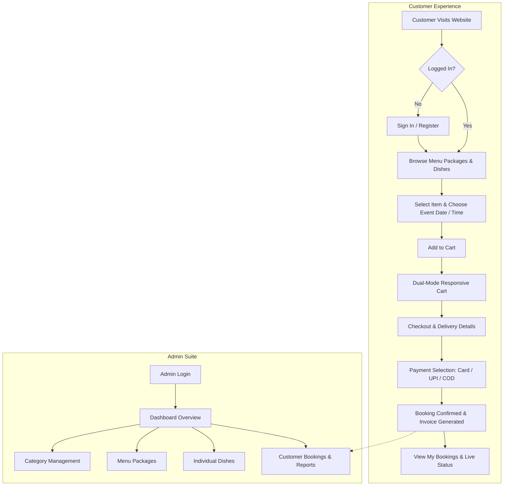

# 🍽️ Feastify — Online Catering Management System

<p align="center">
  
</p>

<p align="center">
  <strong>A full-stack, mobile-responsive event catering management platform & online food booking system.</strong>
</p>

<p align="center">
  
  
  
  
  
  
</p>

---

## 📖 Table of Contents
1. [Overview](#-overview)
2. [Key Features](#-key-features)
   - [Customer Storefront & App Experience](#customer-storefront--app-experience)
   - [Admin Management Suite](#admin-management-suite)
3. [System Architecture & Flow](#-system-architecture--flow)
4. [Technology Stack](#-technology-stack)
5. [Project Directory Structure](#-project-directory-structure)
6. [Installation & Setup](#-installation--setup)
   - [Prerequisites](#prerequisites)
   - [Step 1: Clone Repository](#step-1-clone-repository)
   - [Step 2: Database Import](#step-2-database-import)
   - [Step 3: Server Configuration](#step-3-server-configuration)
   - [Step 4: Launch Application](#step-4-launch-application)
7. [Default Credentials](#-default-credentials)
8. [Mobile App Experience](#-mobile-app-experience)
9. [Contributing & License](#-contributing--license)

---

## 🌟 Overview

**Feastify** is a comprehensive, production-grade event catering management system engineered for professional caterers, banquet services, event planners, and culinary businesses. 

It provides an **end-to-end customer booking flow** — from browsing curated catering menu packages (Wedding Buffets, Corporate Gala, Birthday Feasts) and individual a la carte dishes, to scheduling event dates, selecting meal times (Breakfast, Lunch, High Tea, Dinner), managing a mobile-first shopping cart, and checking out through an integrated payment workflow.

Administrators benefit from a **centralized management dashboard** to oversee categories, menu packages, individual dishes, customer reservations, and operational reports.

---

## ✨ Key Features

### Customer Storefront & App Experience
- 📱 **Mobile App-Like Bottom Navigation**: A sticky, blur-backed bottom navigation bar optimized for smartphones (Home, Menus, Dishes, Cart with real-time badge count, and User Account).
- 🛒 **Dual-Mode Responsive Shopping Cart**:
  - **Desktop / Tablet View (≥768px)**: Comprehensive data table with thumbnails, pricing, quantity counters, program dates, and item totals.
  - **Mobile Phone View (<768px)**: Modern card-based UI with rounded thumbnails, date & time badges, pricing breakdown, and instant item removal.
- 🥘 **Catering Menu Packages & A La Carte Dishes**: Customers can book complete tiered packages per plate or mix-and-match specific regional dishes.
- 📅 **Smart Event Scheduling**: Built-in date picker and meal-time slots (`Breakfast`, `Lunch`, `Dinner`, `High Tea`) attached directly to each booked item.
- 💳 **Integrated Checkout & Payment Simulation**: Support for Credit/Debit Cards, UPI / QR Code, Net Banking, and Cash on Event Day.
- 📦 **Order Tracking & Booking History**: View live status of booked events (`Pending`, `Confirmed`, `Completed`, `Cancelled`) with complete invoices.
- 🔐 **Secure Authentication**: Customer sign-up and login with password hashing and session verification.
- 💬 **Interactive Contact & Service Showcase**: Static presentation of corporate, wedding, and social catering services with a direct inquiry form.

### Admin Management Suite
- 📊 **Metric Dashboard**: Quick counters for registered categories, active menus, catalog items, and total bookings.
- 🏷️ **Category Management**: Create, edit, and soft-delete food categories with image upload.
- 🍱 **Menu Package Management**: Configure multi-course catering packages with price per plate and descriptions.
- 🍲 **Item Catalog Management**: Add individual dishes with category association, pricing, and high-resolution food imagery.
- 📋 **Booking Administration**: Review customer orders, filter by event date, and verify customer delivery addresses and phone numbers.
- 📈 **Catering Reports**: Summary statistics for revenue and booked guest capacities.

---

## 🔄 System Architecture & Flow



---

## 🛠️ Technology Stack

| Layer | Technology | Details |
| :--- | :--- | :--- |
| **Backend** | **PHP 8.2+** | Structured object-oriented data access with `DataAccess.php`, `Forming.php`, and `Validation.php` |
| **Database** | **MySQL 8.0+** | Relational schema with normalized tables (`booking`, `category`, `item`, `login`, `menu`) |
| **Frontend** | **Bootstrap 5.3** | Responsive grid, utilities, modern modal cards, and fluid layouts |
| **Styling** | **Custom CSS3** | `app-responsive.css` for mobile native app-like bottom navigation, card layouts, and touch targets |
| **Icons & Fonts** | **FontAwesome 5/6 & Google Fonts** | Open Sans, Raleway typography, and vector icons |
| **Scripts** | **jQuery & Vanilla ES6+** | Dynamic event handlers, cart badges, client validation, and smooth scrolling |

---

## 📁 Project Directory Structure

```text
catering/
├── admin/                         # Administrator control panel
│   ├── category.php               # Category creation form
│   ├── categoryview.php           # Category listing & actions
│   ├── editcategory.php           # Edit existing category
│   ├── menu_prj.php               # Menu package creation form
│   ├── menuview.php               # Menu package listing
│   ├── editmenu.php               # Edit menu package
│   ├── item_prj.php               # Catalog item creation form
│   ├── itemview.php               # Catalog item listing
│   ├── edititem.php               # Edit catalog item
│   ├── bookingview.php            # Customer bookings & orders
│   ├── report.php                 # Summary reports & analytics
│   ├── header.php                 # Admin navigation bar
│   ├── footer.php                 # Admin closing layout
│   └── index.php                  # Admin dashboard / metrics
│
├── customer/                      # Customer storefront & portal
│   ├── index.php                  # Storefront homepage & hero carousel
│   ├── menu.php                   # Menu packages catalog
│   ├── submenu.php                # Individual dishes catalog
│   ├── bookingmenu.php            # Menu package event date/time booking
│   ├── booking_item.php           # Individual dish booking
│   ├── cart.php                   # Mobile-responsive dual-mode cart
│   ├── cancel_item.php            # Remove item from cart
│   ├── checkout.php               # Event delivery & contact details
│   ├── payments.php               # Payment method selection
│   ├── mybooking.php              # Customer booking history & status
│   ├── service.php                # Catering services & offerings
│   ├── contact.php                # Inquiries & direct contact
│   ├── login.php                  # Customer login
│   ├── registration.php           # Customer registration
│   ├── logout.php                 # Session termination
│   ├── head.php                   # Customer header & mobile tab bar
│   ├── footer.php                 # Customer footer & scripts
│   └── css/
│       ├── app-responsive.css     # Native app-like mobile styles
│       ├── bootstrap.min.css      # Bootstrap framework
│       └── style.css              # Custom storefront theme
│
├── classes/                       # Backend architecture & helpers
│   ├── DataAccess.php             # Database abstraction layer
│   ├── Forming.php                # Dynamic HTML form generator
│   └── Validation.php             # Form validation & security filters
│
├── config/                        # Global system configuration
│   ├── autoload.php               # Path configurations & class loader
│   └── database.php               # Database connection parameters
│
├── category_images/               # Uploaded category assets
├── menu_images/                   # Uploaded menu package assets
├── item_images/                   # Uploaded dish item assets
├── uploads/                       # System media storage
├── catering.sql                   # Clean MySQL database schema & sample data
├── index.php                      # Root entrypoint (redirects to customer portal)
├── .gitignore                     # Git exclusion rules
└── README.md                      # Project documentation
```

---

## 🚀 Installation & Setup

### Prerequisites
- **Web Server**: Apache 2.4+ (e.g. [WampServer](https://www.wampserver.com/), [XAMPP](https://www.apachefriends.org/), or standard LAMP/LEMP stack)
- **PHP**: Version 8.0 or higher (PHP 8.2 recommended)
- **Database**: MySQL 8.0+ or MariaDB 10.4+
- **Version Control**: Git

### Step 1: Clone Repository
```bash
git clone https://github.com/<your-username>/catering.git
cd catering
```

If deploying into WampServer or XAMPP, place the folder in your web root:
- **WAMP**: `C:/wamp64/www/catering` (or create a directory junction: `mklink /J "C:\wamp64\www\catering" "E:\catering"`)
- **XAMPP**: `C:/xampp/htdocs/catering`

### Step 2: Database Import
1. Open **phpMyAdmin** (`http://localhost/phpmyadmin/`) or open your MySQL terminal.
2. Create a new database named `catering`:
   ```sql
   CREATE DATABASE catering CHARACTER SET utf8mb4 COLLATE utf8mb4_unicode_ci;
   ```
3. Import the canonical dump file `catering.sql`:
   ```bash
   mysql -u root -p catering < catering.sql
   ```

### Step 3: Server Configuration
Check `config/autoload.php` and verify the `BASE_PATH` points to your project location:
```php
define('BASE_PATH', 'C:/wamp64/www/catering/');
```

Verify your database credentials in `config/database.php` (or `classes/DataAccess.php`):
```php
$db_host = "localhost";
$db_user = "root";
$db_pass = "";
$db_name = "catering";
```

### Step 4: Launch Application
- **Customer Storefront**: [http://localhost/catering/](http://localhost/catering/) (or [http://localhost/catering/customer/index.php](http://localhost/catering/customer/index.php))
- **Admin Control Panel**: [http://localhost/catering/admin/index.php](http://localhost/catering/admin/index.php)

---

## 🔑 Default Credentials

| Portal | URL | Username / Email | Password | Role |
| :--- | :--- | :--- | :--- | :--- |
| **Admin Panel** | `/admin/index.php` | `admin` | `1234` | Full Administrator |
| **Customer Storefront** | `/customer/login.php` | Registered customer email | Your password | Verified Customer |

> 💡 *To register a new customer, click **Register** on the top navigation bar or mobile menu.*

---

## 📱 Mobile App Experience

The customer storefront is designed with modern **Mobile-First App UX**:
- **Sticky Tab Bar**: Quick one-thumb access to *Home*, *Menus*, *Dishes*, *Cart*, and *Account*.
- **Live Cart Badge**: Displays real-time quantity of items in the cart directly in the bottom navigation bar.
- **Card-Based Mobile Cart**: Converts complex 8-column tabular data into readable, finger-friendly cards on small screens.
- **Optimized Touch Targets**: Buttons and interactive controls adhere to minimum 44px tap target guidelines.

---

## 📄 Contributing & License

Contributions, feature requests, and bug reports are welcome! Feel free to open an issue or pull request.

This project is licensed under the **MIT License**.
